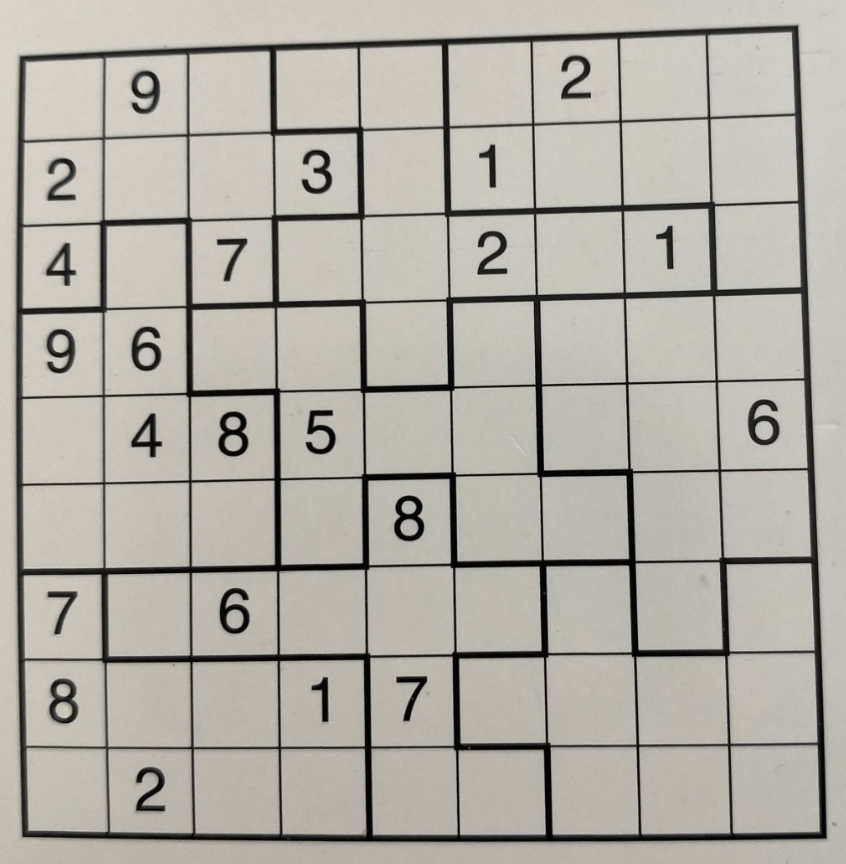
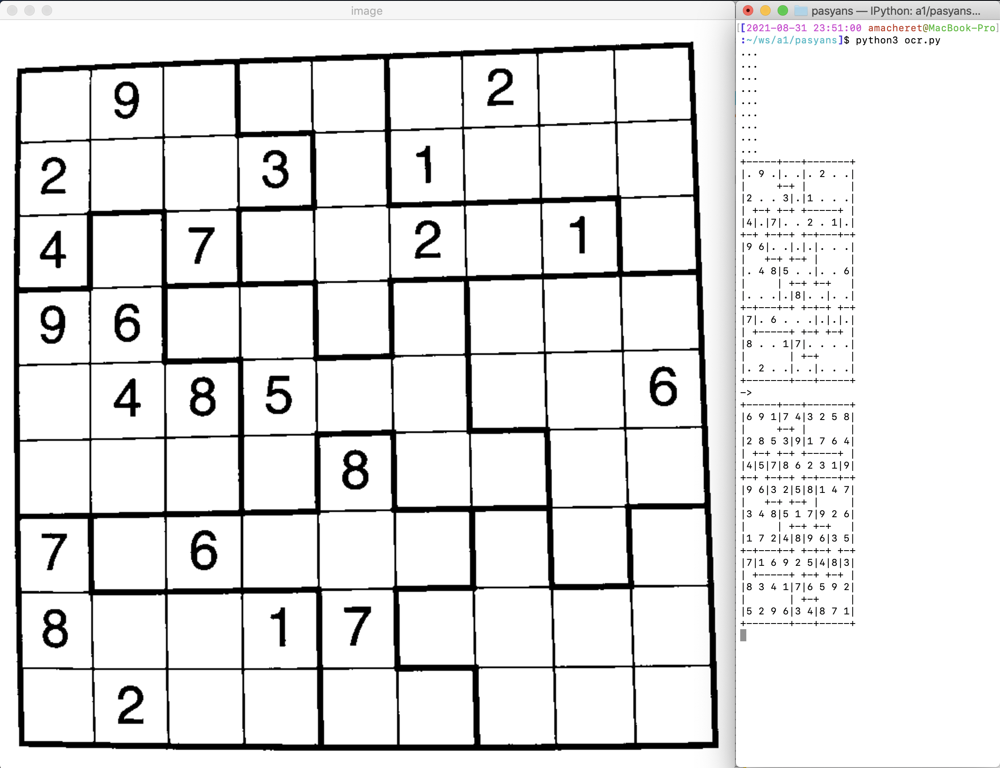

# Irregular Sudoku OCR Solver

Solves an irregular sudoku via OCR.

Probably requires a lot of tweaking to use correctly.

# Requirements

* Python 3
* `pip3 install opencv-python`
* `pip3 install pytesseract`
* `pip3 install numpy`
* `pip3 install imutils`

# Example

Before:

After:

